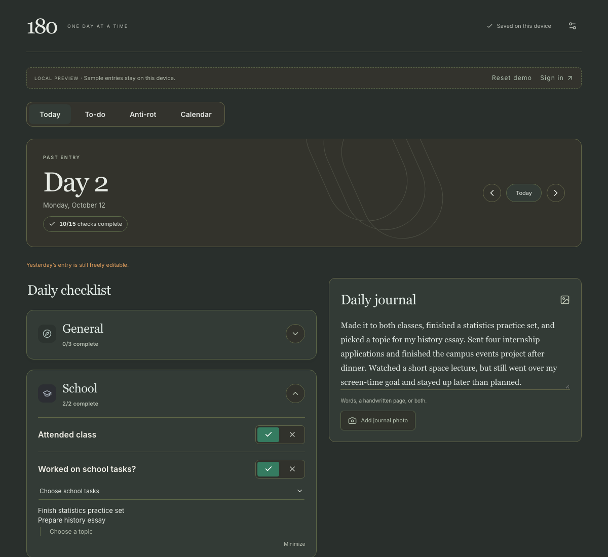
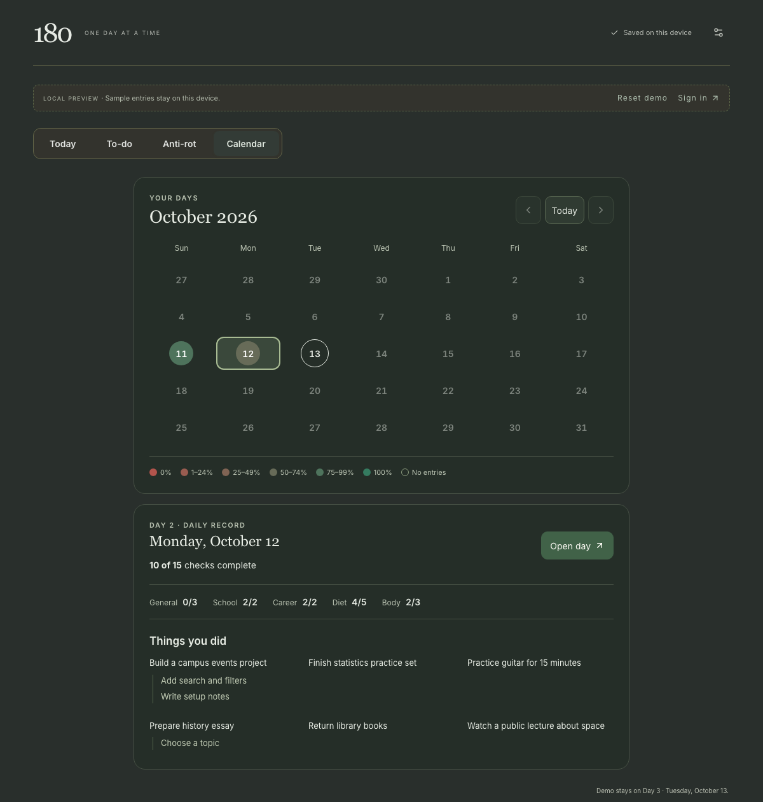
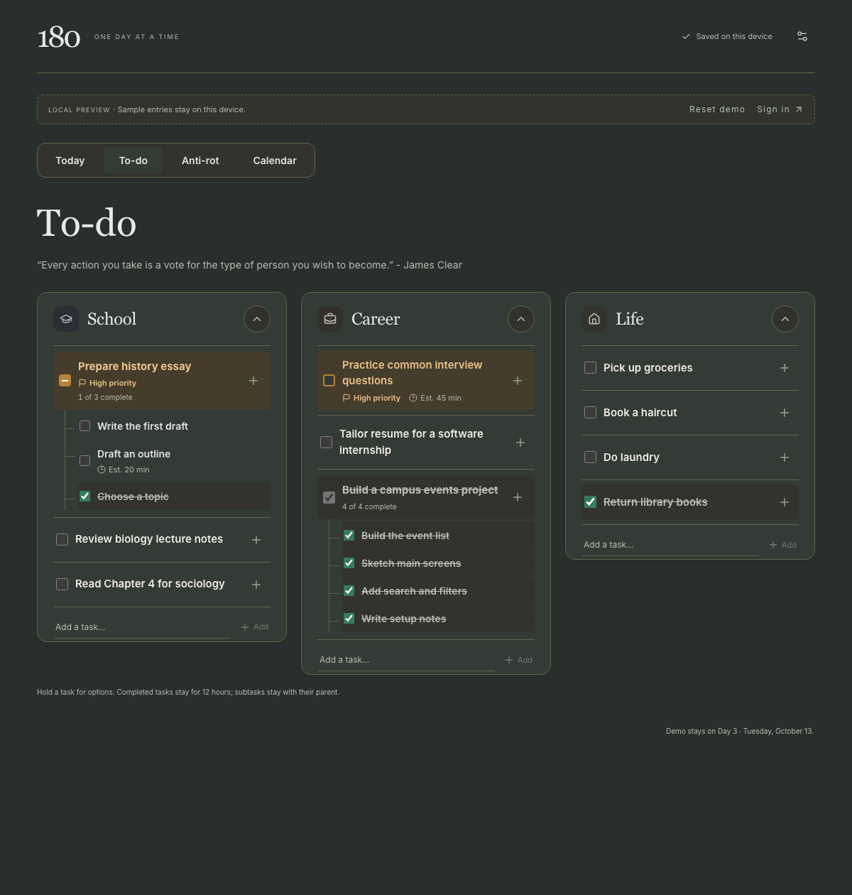
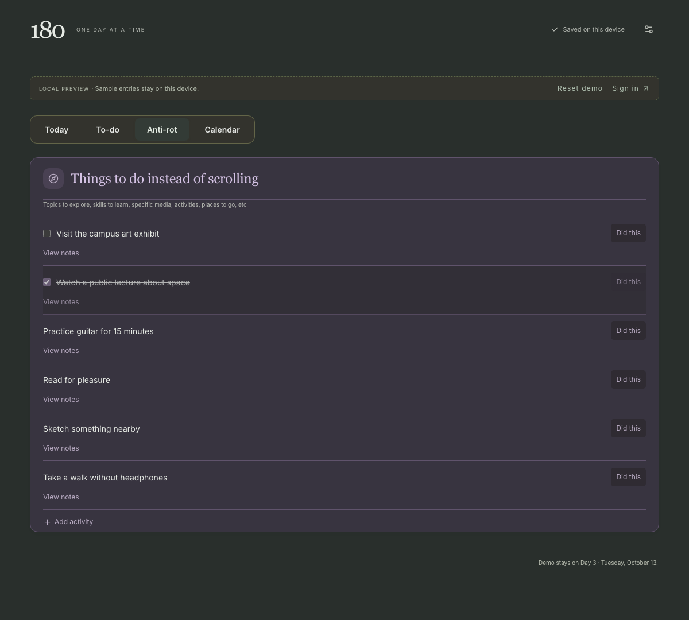
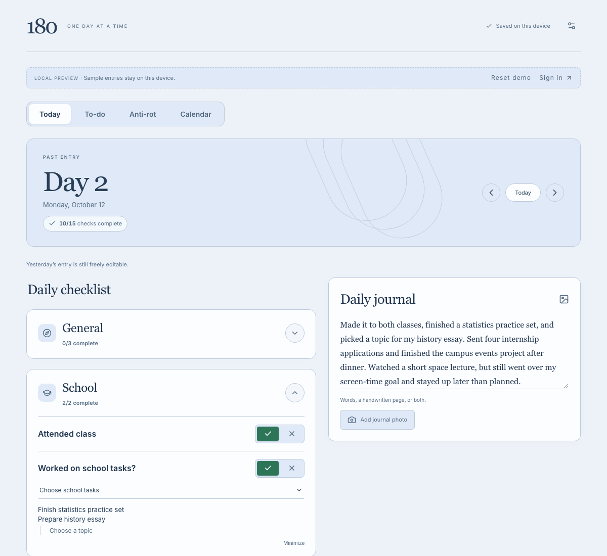
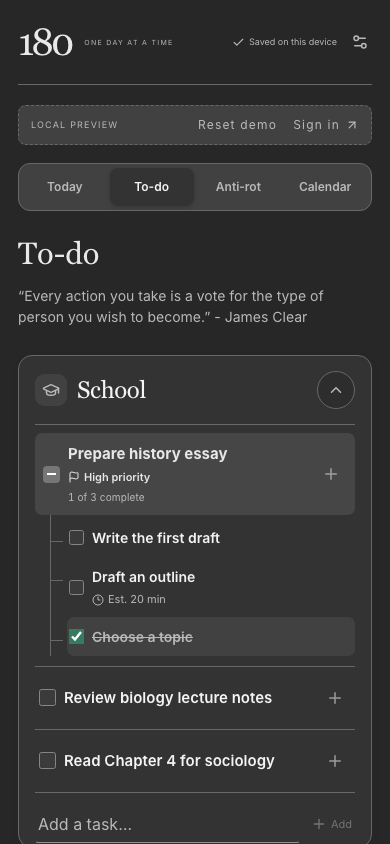

# 180

**One day at a time.** An offline-first productivity app for daily check-ins, task planning, and journaling—with a calendar that turns saved entries into a history of what you did.

[**Try the live demo →**](https://180-vlfh.vercel.app) · [Architecture](docs/architecture.md) · [Local development](docs/development.md)

[](https://github.com/drat-git/180/actions/workflows/ci.yml)

180 brings everyday habits, longer-running tasks, and reflection into one place. It saves changes locally as you make them, remains usable offline after loading, and synchronizes the private account when a connection returns.

## Explore the demo

Open the [live app](https://180-vlfh.vercel.app) and choose **Try the demo mode**. No account or setup is required.

- Browse two populated sample days using the arrows or **Calendar**.
- Edit the daily checklist, add a task or subtask, and try an **Anti-rot** activity.
- Change the appearance through the settings button. Use **Reset demo** to restore the samples.

The demo uses synthetic data and a fixed three-day timeline. Your edits stay in your browser and are separate from the private account; demo mode never uploads them. The cloud-backed app currently supports a single owner, rather than public account registration.

## Features

| Area                     | What you can do                                                                                                                                                                          |
| ------------------------ | ---------------------------------------------------------------------------------------------------------------------------------------------------------------------------------------- |
| **Daily check-ins**      | Record answers, times, counters, meal notes, and optional explanations. Completion follows each question’s rules, including thresholds and answers where “No” earns completion.          |
| **To-do lists**          | Organize School, Career, and Life tasks with subtasks, priority, and time estimates. Completing School or Career tasks also records work on the corresponding day.                       |
| **Interactive calendar** | Browse completion-colored dates, view category totals and **Things you did**, and open the original daily entry. History retains recorded task titles and relationships.                 |
| **Anti-rot**             | Keep reusable ideas and one-time activities as alternatives to scrolling. Log what you did and revisit it in past-day recaps.                                                            |
| **Journal**              | Write a daily reflection and attach photos, with local persistence and retryable cloud uploads in the private app.                                                                       |
| **Appearance & PWA**     | Choose light/dark mode and independent app, completion, and Anti-rot palettes. Install the production app for offline access; the private app also supports opt-in daily push reminders. |

## Screenshots

All screenshots show the public demo with **Forest & Rust** completion colors and **Classic** Anti-rot colors. Most use **Classic Dark**; the final two show other app themes and a mobile layout.

### Daily check-in · Classic Dark



<table>
  <tr>
    <td width="50%" valign="top"><strong>Calendar · Classic Dark</strong><br><br></td>
    <td width="50%" valign="top"><strong>To-do · Classic Dark</strong><br><br></td>
  </tr>
  <tr>
    <td width="50%" valign="top"><strong>Anti-rot · Classic Dark</strong><br><br></td>
    <td width="50%" valign="top"><strong>Daily check-in · Blue Slate Light</strong><br><br></td>
  </tr>
</table>

<details>
<summary><strong>Mobile To-do · Monochrome Dark</strong></summary>
<br>

</details>

## Engineering choices

The main engineering challenge is keeping local edits, cloud synchronization, and historical views consistent when connections fail or records change later.

| Decision                        | Why it matters                                                                                                                                                                                             |
| ------------------------------- | ---------------------------------------------------------------------------------------------------------------------------------------------------------------------------------------------------------- |
| **Transactional local writes**  | A Dexie transaction saves the record and queues its operation together. Text saves locally on each change; only network work is debounced.                                                                 |
| **Field-level synchronization** | Server RPCs merge changed fields under a row lock. Edits to different fields can coexist; the last server-applied edit wins when the same field conflicts. Pending local patches overlay incoming records. |
| **Idempotent retries**          | Operation receipts prevent a lost acknowledgement from applying a command twice. Task completion, history, and its daily contribution are committed atomically.                                            |
| **Retained history**            | Task events and activity snapshots keep past accomplishments readable after items are renamed, reopened, deleted, or removed from the active list.                                                         |
| **Explicit time semantics**     | Days roll over at 2 AM in the device’s timezone. Calendar-date arithmetic avoids treating daylight-saving days as fixed 24-hour intervals.                                                                 |
| **Account isolation**           | Local records are partitioned by identity. The private backend uses ownership checks, row-level security, and a private journal bucket; demo records stay local.                                           |

See [the architecture notes](docs/architecture.md) for the data flow, failure handling, and tradeoffs.

## Stack

| Layer                | Technologies                                                                  |
| -------------------- | ----------------------------------------------------------------------------- |
| Interface            | React 19, TypeScript, Tailwind CSS, Lucide icons                              |
| Local persistence    | Dexie and IndexedDB                                                           |
| Backend              | Supabase Auth, Postgres, Storage, Edge Functions, and Cron                    |
| Build & installation | Vite, custom Workbox service worker, Vercel hosting                           |
| Verification         | Vitest, Testing Library, Playwright, and rollback-only SQL integration suites |

## Run locally

Use **Node.js 22.12+** and npm. The demo needs no environment variables or backend connection.

```sh
git clone https://github.com/drat-git/180.git
cd 180
npm ci
npm run dev
```

Open [localhost:3000](http://localhost:3000) and choose **Try the demo mode**. To test the production PWA and offline reloads:

```sh
npm run build
npm run preview
```

Open [localhost:4173](http://localhost:4173). Service-worker caching is enabled in production builds, rather than the development server.

## Verification

```sh
npm test
npm run build
npx playwright install chromium
npm run test:e2e
```

Unit tests cover completion rules, date boundaries, local-write failures, account isolation, merge behavior, and retry handling. Playwright exercises production-PWA workflows in desktop and phone-sized Chromium contexts. SQL suites cover backend validation, ownership, transactions, and replay safety.

GitHub Actions runs unit tests and a production build. Browser and database suites are separate checks; phone emulation does not establish physical iPhone installation or push delivery. See [development and testing](docs/development.md#testing) for details, and [the validation log](VALIDATION.md) for dated implementation checks.

## Next step

**Custom checklist creation** is the remaining major feature: user-defined questions, counters, notes, and completion rules. The current app uses predefined checklist templates; customizable task and Anti-rot items are already available.
