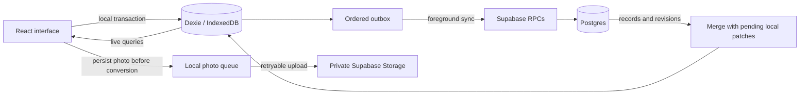

# Architecture

[Back to the project](../README.md) · [Development guide](development.md)

180 treats the browser’s database as the working copy. The interface reads local records, and the authenticated app synchronizes queued operations with Supabase while it is open. The public demo uses the same local workflows with a separate identity and sample data.

## Data flow

## Local writes and synchronization

`LocalRepository` coordinates local entry, configuration, typed-answer, task, and activity operations. A transaction stores each change with its outbox operation, so a successful local save cannot leave the cloud queue behind. Text updates are saved locally on every change; network work is debounced.

Foreground sync runs after changes, reconnects, focus, and periodic checks while the app is open. Web Locks serialize workers across tabs. Server operation receipts make retries safe if a response is lost after the server applies a command. Synchronization does not depend on browser background-sync support.

Daily RPCs patch only changed fields under a day-row lock. Changes to separate fields merge, while the last server-applied edit to the same field wins. Journal text follows that same rule; there is no collaborative text merging. Incoming cloud records are overlaid with pending local changes so a pull does not discard newer unsynced input.

Task completion, its event history, and any linked daily contribution commit together. Each command captures the list, question, answer generation, and configuration revision that applied when the action was recorded. Client reconciliation replays pending task effects and manual daily edits in outbox order. Same-day undo removes automatic work without discarding independent manual selections; undo on a later day preserves earlier accomplishments.

## Data and history

| Data                             | Purpose                                                                                                                         |
| -------------------------------- | ------------------------------------------------------------------------------------------------------------------------------- |
| Account profiles                 | Server creation time, signup timezone, immutable Day 1 anchor, onboarding status and frozen initial definitions.                |
| Daily entries                    | Original validated daily fields and journal text, retained for existing records and queued-client compatibility.                |
| Configuration changes            | Immutable effective-dated field patches for blocks, questions, and lists, with operation identity, sequence, and base revision. |
| Custom answers                   | Typed values, follow-up fields, and task selections keyed by account, logical date, item ID, and answer generation.             |
| Tasks and task events            | Current task state plus completion/reopening transitions, recorded dates, and title/relationship snapshots.                     |
| Anti-rot items, logs, and events | Reusable/one-time ideas, daily activity logs, and completion history with manual/automatic provenance.                          |
| Journal images                   | Stable identifiers, upload state, cached blobs, and deletion tombstones.                                                        |
| Outbox and receipts              | Ordered local operations and server acknowledgements for idempotent retries.                                                    |

The active list and historical record serve different purposes. Completed items leave the active view after their display window, but their records and events remain. Historical selections retain titles and parent/child relationships rather than resolving everything through today’s task list. Renaming or deleting an item therefore does not rewrite a past day.

Calendar progress uses the same definition resolver and rule evaluator as the daily view and editor preview. It is derived from applicable checklist questions, each worth one check. Tasks, journal text, and Anti-rot activity do not independently add checks. The **Things you did** preview combines recorded task work and activity history, keeping subtasks grouped with their parent. Calendar reads do not create or modify daily records.

## Configurable definitions and answers

The legacy personal checklist, starter catalog and isolated demo use the same generic definition schema. New accounts resolve their frozen initial definitions, then apply dated configuration revisions; only the explicitly backfilled legacy profile resolves the original personal template and its cutovers. Unknown accounts never fall back to that template. New questions offer the original main controls: Yes/No, time of day, time spent, or a connected To-do list. Text notes, counters, choices and notes for each count are follow-up fields. Earlier stored checkbox definitions display with Yes/No controls while retaining their saved boolean values and answer generations. Retired standalone types remain readable for historical compatibility and are not offered for new questions. Items define an input type, completion predicate, follow-ups, schedule, and optional To-do list connection. Supported predicates compare values, test presence, and combine conditions with all/any/not. Required visible follow-ups participate in the parent item’s completion; they do not add checks.

Configuration changes are field patches ordered by sequence and filtered by effective logical date. Saving a tomorrow threshold therefore does not erase an unrelated label change saved today afterward. Stable IDs separate identity from labels and positions. Renaming or reordering preserves answers; changing an input type, list binding, or incompatible choice schema advances its answer generation. Previous generations remain stored and are never guessed into a new type. Archival stops future use while retaining prior definitions and answers.

The checklist editor offers today or the next logical day as its effective date. List management applies immediately; connecting or disconnecting a daily question is a separate dated change. Each list has at most one active linked question. Relevant questions appear for applicable unfinished work, recorded completion, or an existing answer; an always-show option still respects item and block schedules. Archiving a list removes its active task view and future deadline markers without discarding recorded work or automatically removing its daily question.

IndexedDB schema version 4 adds account-scoped `configurations` and `customAnswers` stores. Postgres stores their equivalents in `config_changes` and `custom_answers`. Original daily fields and queued operations remain readable; original-schema edits are mirrored for compatible clients. New answer operations patch the main value, individual follow-up fields, and selections independently. Incoming answers are merged with pending local intent rather than replacing unsynced fields.

Configuration writes use an optimistic base revision. A conflicting draft remains available for review against the latest definitions; it is not silently merged as a whole configuration. Local changes and their outbox records share a transaction. Operation IDs and server receipts survive retries, and linked task contributions preserve their captured question and generation even if configuration changes before delivery.

## Dates and appearance

Each account stores a server-derived start date from its Auth creation timestamp, signup IANA timezone and **2 AM** boundary (UTC fallback). Setup completed later keeps that anchor. Current logical dates follow **2 AM in the current device timezone**, clamped to the stored start date so rendering, operation capture and backend validation never produce Day 0. Stored entries keep their calendar date when the device changes timezone. Day-number and navigation calculations use calendar ordinals, avoiding errors across daylight-saving transitions. The demo instead uses a fixed October 11–13, 2026 timeline so its samples remain reproducible.

Mode, app palette, completion palette, and Anti-rot palette are independent settings. Calendar surfaces follow light/dark mode while staying independent of the app background palette; calendar bubbles follow the chosen completion palette. Preferences are device-local in the signed-in app and session-local in the demo.

Top-level tasks can carry a date-only deadline or a fixed UTC instant, with optional deadlines stored alongside priority and estimates. Active tasks sort by priority, earliest deadline, then creation order; undated tasks come last within each priority group. Date-only deadlines become overdue at local midnight after their date, independently of the checklist’s 2 AM boundary. Timed deadlines display in the device’s current timezone; the demo uses its frozen Eastern clock. Deadline edits use the existing task operation queue and do not change task history, daily progress, parent completion, or archive timers. Subtasks have no deadline. The calendar marks future dates with unfinished root-task deadlines and shows a read-only preview using the list’s title. Rescheduling or completing the last due task removes its marker and returns an unavailable selection to Today. Deadlines do not schedule notifications.

## Photos, installation, and reminders

Photo originals are persisted before conversion. JPEG, PNG, WebP, and HEIC inputs are normalized to oriented JPEGs with a maximum 2560-pixel longest edge. Pending uploads survive reloads, downloaded images are cached locally, and tombstones protect deleted photos from reappearing. Uncached remote images still need a connection.

A custom Workbox service worker precaches the production application and prompts for updates. Updates are held while local saving or a local-write error needs attention. Development mode does not install the production cache.

Opt-in account reminders use Web Push. A Supabase Cron job invokes the reminder dispatcher; server-side delivery claims control retries and duplicate sends. Installation-specific settings retain an IANA timezone and schedule the next future occurrence. Notification payloads contain no answers or task titles. The public demo can send one local test notification after browser permission, without an account, push subscription, or backend request. It uses a separate notification tag and does not enable scheduled reminders. On iPhone, notification support requires Home Screen installation.

## Access model and failure behavior

Email/password signup creates an account profile through an Auth trigger. The client loads that account’s profile before rendering or synchronizing. Completed setup is required for normal data access. Server functions and row-level policies enforce authenticated account ownership; journal object paths contain that identity and storage stays private. Profile initialization fields have no client write grant. Email confirmation is disabled at launch; password recovery is hidden behind an availability setting until email delivery is configured. Browser builds contain only the publishable client key. Server credentials and push secrets remain outside the client.

Local data is partitioned by account ID. Signing out locks the private interface while retaining that account’s unsynced changes for its next sign-in. Demo identities use a separate namespace and never queue cloud operations.

- **Network failure or expired authentication:** saved local changes remain queued; the interface reports that sync is paused.
- **Local-write failure:** the latest unsaved patch remains in memory with a retry action, and navigation is blocked until it is saved. Closing the page can lose that unsaved patch.
- **Browser storage deletion:** locally retained data can be lost. Cloud sync is not a substitute for a successful upload, and the app does not claim unsynced work is backed up.

## Code map

| Location                                                                                                                        | Responsibility                                                                           |
| ------------------------------------------------------------------------------------------------------------------------------- | ---------------------------------------------------------------------------------------- |
| [`src/components`](../src/components)                                                                                           | Daily controls, tasks, calendar, activities, journal, and settings                       |
| [`src/lib/repository.ts`](../src/lib/repository.ts) / [`db.ts`](../src/lib/db.ts)                                               | Transactional local persistence and account-separated tables                             |
| [`src/lib/sync.ts`](../src/lib/sync.ts) and sync helpers                                                                        | Foreground orchestration, cloud operations, and reconciliation                           |
| [`src/lib/calendar.ts`](../src/lib/calendar.ts) / [`dates.ts`](../src/lib/dates.ts)                                             | Historical previews and logical-date calculations                                        |
| [`src/lib/customization.ts`](../src/lib/customization.ts) / [`customizationTypes.ts`](../src/lib/customizationTypes.ts)         | Definition resolution, typed answers, validation, templates, and shared completion rules |
| [`src/lib/customizationStore.ts`](../src/lib/customizationStore.ts) / [`customizationSync.ts`](../src/lib/customizationSync.ts) | Local answer/configuration integration, conflict handling, and cloud reconciliation      |
| [`src/lib/demo.ts`](../src/lib/demo.ts) / [`appMode.ts`](../src/lib/appMode.ts)                                                 | Synthetic samples and separate demo policy                                               |
| [`src/sw.ts`](../src/sw.ts)                                                                                                     | Production caching, update handling, and push events                                     |
| [`supabase`](../supabase)                                                                                                       | Migrations, Edge Functions, and SQL integration suites                                   |

Customization is available to every initialized account and isolated demo identities. Moving existing tasks between lists remains outside scope.

## Account initialization

Onboarding selections are local metadata scoped to the account. Completion requires an active authenticated connection and sends only an operation ID, immutable starter version and selected catalog IDs. A private, narrowly granted initialization function locks the profile, validates those IDs and dependencies against the server catalog, inserts selected unfinished tasks and activities, freezes initial definitions, and marks setup complete in one transaction. A competing attempt returns the first completed profile; receipt replay never reseeds content. It creates no answers, logs or historical events. Later starter releases do not alter existing accounts.

IndexedDB version 5 adds legacy profile metadata for the pre-public cached account while retaining entries, queues, operation IDs and editor drafts. New profiles and baselines are cached per account; normal offline use begins after setup has been confirmed and its initial data loaded. Demo signup starts a separate identity without copying samples.

Reminder installation IDs are scoped per account on each device, with the original owner’s device ID preserved. The Edge Function verifies a real Auth user and completed profile. It updates only that user’s rows, and uses insertion rather than primary-key upsert for new installations so a foreign ID collision cannot transfer ownership. Endpoint uniqueness and existing dispatcher receipts remain intact.
