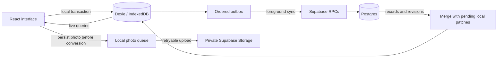

# Architecture

[Back to the project](../README.md) · [Development guide](development.md)

180 treats the browser’s database as the working copy. The interface reads local records, and the authenticated app synchronizes queued operations with Supabase while it is open. The public demo uses the same local workflows with a separate identity and sample data.

## Data flow

## Local writes and synchronization

`EntryRepository` coordinates local entry, task, and activity operations. A transaction stores each change with its outbox operation, so a successful local save cannot leave the cloud queue behind. Text updates are saved locally on every change; network work is debounced.

Foreground sync runs after changes, reconnects, focus, and periodic checks while the app is open. Web Locks serialize workers across tabs. Server operation receipts make retries safe if a response is lost after the server applies a command. Synchronization does not depend on browser background-sync support.

Daily RPCs patch only changed fields under a day-row lock. Changes to separate fields merge, while the last server-applied edit to the same field wins. Journal text follows that same rule; there is no collaborative text merging. Incoming cloud records are overlaid with pending local changes so a pull does not discard newer unsynced input.

Task completion, its event history, and any School/Career daily contribution commit together. Client reconciliation replays pending task effects and manual daily edits in outbox order. Same-day undo removes automatic work without discarding independent manual selections; undo on a later day preserves earlier accomplishments.

## Data and history

| Data                             | Purpose                                                                                                     |
| -------------------------------- | ----------------------------------------------------------------------------------------------------------- |
| Daily entries                    | Typed, validated JSONB answers keyed by owner and logical date; local equivalents power offline reads.      |
| Tasks and task events            | Current task state plus completion/reopening transitions, recorded dates, and title/relationship snapshots. |
| Anti-rot items, logs, and events | Reusable/one-time ideas, daily activity logs, and completion history with manual/automatic provenance.      |
| Journal images                   | Stable identifiers, upload state, cached blobs, and deletion tombstones.                                    |
| Outbox and receipts              | Ordered local operations and server acknowledgements for idempotent retries.                                |

The active list and historical record serve different purposes. Completed items leave the active view after their display window, but their records and events remain. Historical selections retain titles and parent/child relationships rather than resolving everything through today’s task list. Renaming or deleting an item therefore does not rewrite a past day.

Calendar progress is derived from applicable checklist questions. Tasks, journal text, and Anti-rot activity do not independently add checks. The **Things you did** preview combines recorded task work and activity history, keeping subtasks grouped with their parent. Calendar reads do not create or modify daily records.

## Dates and appearance

The private app uses a local **2 AM** day boundary. Stored entries keep their calendar date when the device changes timezone. Day-number and navigation calculations use calendar ordinals, avoiding errors across daylight-saving transitions. The demo instead uses a fixed October 11–13, 2026 timeline so its samples remain reproducible.

Mode, app palette, completion palette, and Anti-rot palette are independent settings. Calendar surfaces follow light/dark mode while staying independent of the app background palette; calendar bubbles follow the chosen completion palette. Preferences are device-local in the private app and session-local in the demo.

## Photos, installation, and reminders

Photo originals are persisted before conversion. JPEG, PNG, WebP, and HEIC inputs are normalized to oriented JPEGs with a maximum 2560-pixel longest edge. Pending uploads survive reloads, downloaded images are cached locally, and tombstones protect deleted photos from reappearing. Uncached remote images still need a connection.

A custom Workbox service worker precaches the production application and prompts for updates. Updates are held while local saving or a local-write error needs attention. Development mode does not install the production cache.

Opt-in private-app reminders use Web Push. A Supabase Cron job invokes the reminder dispatcher; server-side delivery claims control retries and duplicate sends. Installation-specific settings retain an IANA timezone and schedule the next future occurrence. Notification payloads contain no answers or task titles. The public demo can send one local test notification after browser permission, without an account, push subscription, or backend request. It uses a separate notification tag and does not enable scheduled reminders. On iPhone, notification support requires Home Screen installation.

## Access model and failure behavior

The cloud-backed application currently supports one designated owner. Authenticated identity alone is insufficient: server functions and row-level policies also enforce ownership, and journal storage is private. Browser builds contain only the publishable client key. Server credentials and push secrets remain outside the client.

Local data is partitioned by account ID. Signing out locks the private interface while retaining that account’s unsynced changes for its next sign-in. Demo identities use a separate namespace and never queue cloud operations.

- **Network failure or expired authentication:** saved local changes remain queued; the interface reports that sync is paused.
- **Local-write failure:** the latest unsaved patch remains in memory with a retry action, and navigation is blocked until it is saved. Closing the page can lose that unsaved patch.
- **Browser storage deletion:** locally retained data can be lost. Cloud sync is not a substitute for a successful upload, and the app does not claim unsynced work is backed up.

## Code map

| Location                                                                            | Responsibility                                                     |
| ----------------------------------------------------------------------------------- | ------------------------------------------------------------------ |
| [`src/components`](../src/components)                                               | Daily controls, tasks, calendar, activities, journal, and settings |
| [`src/lib/repository.ts`](../src/lib/repository.ts) / [`db.ts`](../src/lib/db.ts)   | Transactional local persistence and account-separated tables       |
| [`src/lib/sync.ts`](../src/lib/sync.ts) and sync helpers                            | Foreground orchestration, cloud operations, and reconciliation     |
| [`src/lib/calendar.ts`](../src/lib/calendar.ts) / [`dates.ts`](../src/lib/dates.ts) | Historical previews and logical-date calculations                  |
| [`src/lib/demo.ts`](../src/lib/demo.ts) / [`appMode.ts`](../src/lib/appMode.ts)     | Synthetic samples and separate demo policy                         |
| [`src/sw.ts`](../src/sw.ts)                                                         | Production caching, update handling, and push events               |
| [`supabase`](../supabase)                                                           | Migrations, Edge Functions, and SQL integration suites             |

The next major extension is user-defined checklist questions and completion rules. The existing typed templates already exercise answers, counters, thresholds, and notes; the creation interface and configurable definitions remain to be implemented.
